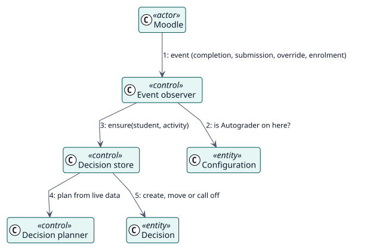

# UC-004 Reconsiderar una decisión cuando algo cambia — realización del análisis

| Resumen | Requisitos | Análisis | Diseño | Implementación | Pruebas |
| --- | --- | --- | --- | --- | --- |
| [Casos de uso](../../../requirements/use-case-overview.svg) | [Requisitos](../../../requirements/use-cases/reconsiderDecision/README.md) | **Análisis** | [Diseño](../../../design/use-cases/reconsiderDecision/README.md) | [Implementación](../../../implementation/use-cases/reconsiderDecision/README.md) | [Pruebas](../../../implementation/use-cases/reconsiderDecision/README.md#pruebas) |

Requisitos: [README](../../../requirements/use-cases/reconsiderDecision/README.md)

## Clases participantes

| Clase | Estereotipo | Responsabilidad |
| --- | --- | --- |
| Observador de eventos | control | Reacciona a los eventos del curso. |
| Planificador de decisiones | control | Planifica con datos actuales. |
| Almacén de decisiones | control | Crea, mueve y anula decisiones. |
| Configuración | entidad | Indica si Autograder está activado. |
| Decisión | entidad | El registro que sigue al curso. |

## Colaboración

## Notas

Las tareas completan el trabajo de los observadores: una recalcula una actividad, otra pone al día a los estudiantes de una actividad y otra vuelve a encolar las tareas que se perdieron.
