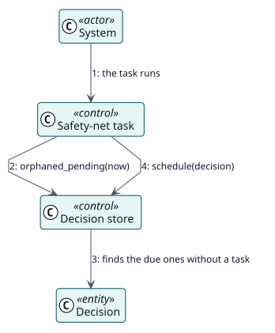

# UC-009 Poner de nuevo en cola las calificaciones que perdieron su tarea — realización del análisis

| Resumen | Requisitos | Análisis | Diseño | Implementación | Pruebas |
| --- | --- | --- | --- | --- | --- |
| [Casos de uso](../../../requirements/use-case-overview.svg) | [Requisitos](../../../requirements/use-cases/requeueLostGrades/README.md) | **Análisis** | [Diseño](../../../design/use-cases/requeueLostGrades/README.md) | [Implementación](../../../implementation/use-cases/requeueLostGrades/README.md) | [Pruebas](../../../implementation/use-cases/requeueLostGrades/README.md#pruebas) |

Requisitos: [README](../../../requirements/use-cases/requeueLostGrades/README.md)

## Clases participantes

| Clase | Estereotipo | Responsabilidad |
| --- | --- | --- |
| Tarea de red de seguridad | control | Busca las decisiones huérfanas y pide ponerlas en cola. |
| Almacén de decisiones | control | Encuentra las decisiones huérfanas y programa sus tareas. |
| Decisión | entidad | El registro pendiente que perdió su tarea. |

## Colaboración

## Notas

La tarea de calificación que esta pone en cola vuelve a comprobarlo todo antes de escribir una calificación.
