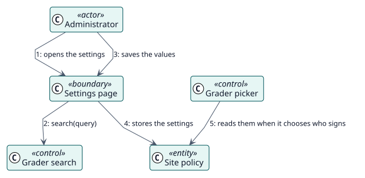

# UC-007 Establecer la política del sitio — realización del análisis

| Resumen | Requisitos | Análisis | Diseño | Implementación | Pruebas |
| --- | --- | --- | --- | --- | --- |
| [Casos de uso](../../../requirements/use-case-overview.svg) | [Requisitos](../../../requirements/use-cases/setSitePolicy/README.md) | **Análisis** | [Diseño](../../../design/use-cases/setSitePolicy/README.md) | [Implementación](../../../implementation/use-cases/setSitePolicy/README.md) | [Pruebas](../../../implementation/use-cases/setSitePolicy/README.md#pruebas) |

Requisitos: [README](../../../requirements/use-cases/setSitePolicy/README.md)

## Clases participantes

| Clase | Estereotipo | Responsabilidad |
| --- | --- | --- |
| Página de ajustes | frontera | Muestra y valida los ajustes. |
| Búsqueda de calificadores | control | Encuentra a los usuarios que pueden ser el calificador de reserva. |
| Selector de docente | control | Aplica la política cuando elige quién firma. |
| Política del sitio | entidad | Los ajustes almacenados. |

## Colaboración

## Notas

La búsqueda de usuarios es una función de servicio web que solo puede llamar quien puede cambiar los ajustes.
