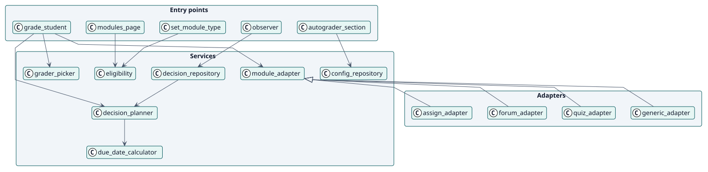
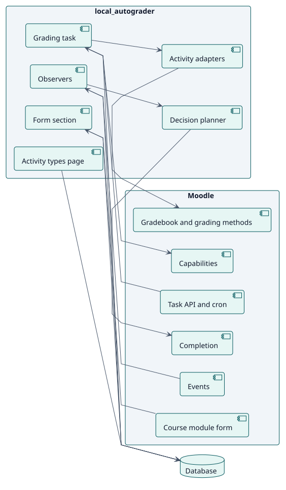
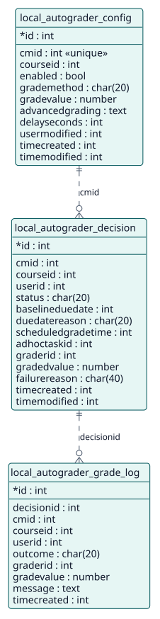

# Diseño

## Arquitectura

Autograder es un plugin local de Moodle con tres capas:

- **Puntos de entrada**: la sección de ajustes del formulario de la actividad, la página de tipos de actividad (un componente React), una función de servicio web, los observadores de eventos y las tareas ad hoc y programadas.
- **Servicios**: clases en `classes/local/`. `config_repository` y `eligibility` guardan la configuración, `decision_planner` y `decision_repository` las decisiones, `grader_picker` la elección del docente y los adaptadores de `module/` el trabajo mediante cada clase de actividad.
- **Persistencia**: tres tablas, `local_autograder_config`, `local_autograder_decision` y `local_autograder_grade_log`.

Dos decisiones dan forma al diseño. Primero, **cada condición se lee de nuevo cuando vence una calificación**, de modo que un evento perdido o un rol que cambió cuesta rapidez como mucho y nunca corrección. Segundo, **cada calificación es su propia tarea ad hoc**, programada para su momento, con una tarea que vuelve a encolar las que perdieron la suya.

## Clases de diseño

## Componentes

El plugin se apoya en la finalización, el libro de calificaciones y los métodos de calificación, los eventos, la API de tareas, las capacidades y la base de datos de Moodle. No añade cambios al núcleo.

## Modelo de datos

## Realizaciones de casos de uso

| ID | Caso de uso | Secuencia |
| --- | --- | --- |
| UC-001 | [Configurar Autograder en una actividad](./use-cases/configureAutograder/README.md) | [secuencia](./use-cases/configureAutograder/sequence.svg) |
| UC-002 | [Elegir los tipos de actividad](./use-cases/chooseActivityTypes/README.md) | [secuencia](./use-cases/chooseActivityTypes/sequence.svg) |
| UC-003 | [Calificar a un estudiante](./use-cases/gradeStudent/README.md) | [secuencia](./use-cases/gradeStudent/sequence.svg) |
| UC-004 | [Reconsiderar una decisión cuando algo cambia](./use-cases/reconsiderDecision/README.md) | [secuencia](./use-cases/reconsiderDecision/sequence.svg) |
