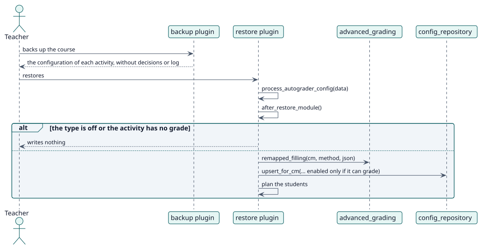

# UC-011 Llevar la configuración en una copia de seguridad del curso — realización del diseño

| Resumen | Requisitos | Análisis | Diseño | Implementación | Pruebas |
| --- | --- | --- | --- | --- | --- |
| [Casos de uso](../../../requirements/use-case-overview.svg) | [Requisitos](../../../requirements/use-cases/carryConfigurationInBackup/README.md) | [Análisis](../../../analysis/use-cases/carryConfigurationInBackup/README.md) | **Diseño** | [Implementación](../../../implementation/use-cases/carryConfigurationInBackup/README.md) | [Pruebas](../../../implementation/use-cases/carryConfigurationInBackup/README.md#pruebas) |

Análisis: [README](../../../analysis/use-cases/carryConfigurationInBackup/README.md)

## Elementos

| Elemento de diseño | Tipo | Código |
| --- | --- | --- |
| `backup_local_autograder_plugin` | copia de seguridad | `backup/moodle2/backup_local_autograder_plugin.class.php:49` |
| `restore_local_autograder_plugin::process_autograder_config` | restauración | `backup/moodle2/restore_local_autograder_plugin.class.php:80` |
| `restore_local_autograder_plugin::after_restore_module` | restauración | `backup/moodle2/restore_local_autograder_plugin.class.php:92` |
| `restore_local_autograder_plugin::remapped_filling` | restauración | `backup/moodle2/restore_local_autograder_plugin.class.php:181` |

## Secuencia

## Contratos

| Operación | Entrada | Salida | Errores |
| --- | --- | --- | --- |
| Backup and restore of the activity | la configuración de la actividad | la configuración de la actividad restaurada | ninguno: lo que no puede funcionar se restaura desactivado o no se restaura |

## Datos que toca

| Tabla o entidad | Operación |
| --- | --- |
| `local_autograder_config` | lectura e inserción |
| `local_autograder_decision` | inserción (planificadas de nuevo) |
