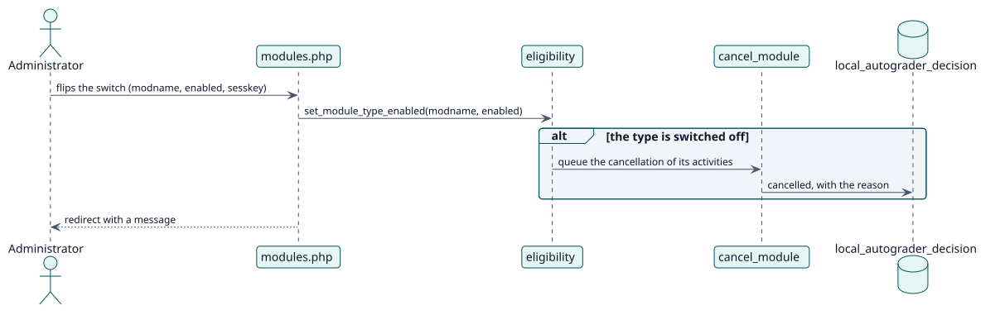

# UC-002 Elegir los tipos de actividad — realización del diseño

| Resumen | Requisitos | Análisis | Diseño | Implementación | Pruebas |
| --- | --- | --- | --- | --- | --- |
| [Casos de uso](../../../requirements/use-case-overview.svg) | [Requisitos](../../../requirements/use-cases/chooseActivityTypes/README.md) | [Análisis](../../../analysis/use-cases/chooseActivityTypes/README.md) | **Diseño** | [Implementación](../../../implementation/use-cases/chooseActivityTypes/README.md) | [Pruebas](../../../implementation/use-cases/chooseActivityTypes/README.md#pruebas) |

Análisis: [README](../../../analysis/use-cases/chooseActivityTypes/README.md)

## Elementos

| Elemento de diseño | Tipo | Código |
| --- | --- | --- |
| `set_module_type::execute` | servicio | `classes/external/set_module_type.php:57` |
| `eligibility::set_module_type_enabled` | servicio | `classes/local/config/eligibility.php:108` |
| Tarea `cancel_module` | tarea | `classes/task/cancel_module.php:41` |

## Secuencia

## Contratos

| Operación | Entrada | Salida | Errores |
| --- | --- | --- | --- |
| `local_autograder_set_module_type(modname, enabled)` | el tipo y el nuevo estado | el estado guardado | tipo que no puede calificarse, sin capacidad |

## Datos que toca

| Tabla o entidad | Operación |
| --- | --- |
| `config_plugins` | actualización (tipos habilitados) |
| `local_autograder_decision` | actualización (canceladas) |
