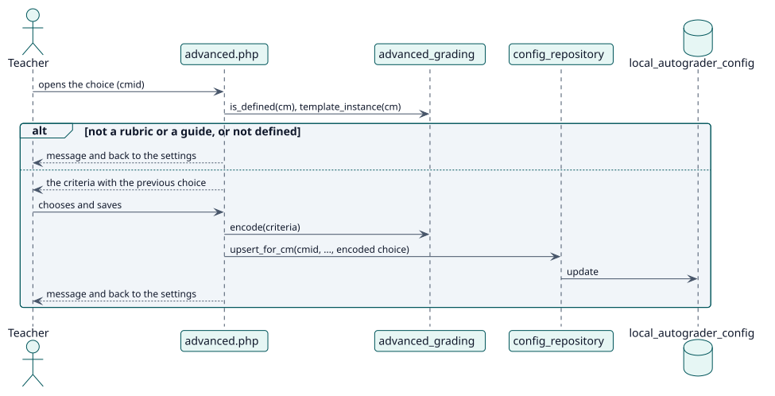

# UC-005 Elegir el resultado de una rúbrica o pauta de calificación — realización del diseño

| Resumen | Requisitos | Análisis | Diseño | Implementación | Pruebas |
| --- | --- | --- | --- | --- | --- |
| [Casos de uso](../../../requirements/use-case-overview.svg) | [Requisitos](../../../requirements/use-cases/chooseAdvancedGrade/README.md) | [Análisis](../../../analysis/use-cases/chooseAdvancedGrade/README.md) | **Diseño** | [Implementación](../../../implementation/use-cases/chooseAdvancedGrade/README.md) | [Pruebas](../../../implementation/use-cases/chooseAdvancedGrade/README.md#pruebas) |

Análisis: [README](../../../analysis/use-cases/chooseAdvancedGrade/README.md)

## Elementos

| Elemento de diseño | Tipo | Código |
| --- | --- | --- |
| `advanced.php` | página | `advanced.php` |
| `advanced_grading::template_instance` | servicio | `classes/local/grading/advanced_grading.php:114` |
| `advanced_grading::encode` | servicio | `classes/local/grading/advanced_grading.php:251` |
| `advanced_grading::filling_is_current` | servicio | `classes/local/grading/advanced_grading.php:271` |
| `config_repository::upsert_for_cm` | servicio | `classes/local/config/config_repository.php:101` |
| `config_updated` | evento | `classes/event/config_updated.php` |

## Secuencia

## Contratos

| Operación | Entrada | Salida | Errores |
| --- | --- | --- | --- |
| `advanced.php?cmid=` | la actividad y, al guardar, una respuesta por cada criterio | una redirección con un mensaje | sin capacidad, la actividad no se califica con una rúbrica ni con una pauta |

## Datos que toca

| Tabla o entidad | Operación |
| --- | --- |
| `local_autograder_config` | actualización (la elección del resultado) |
