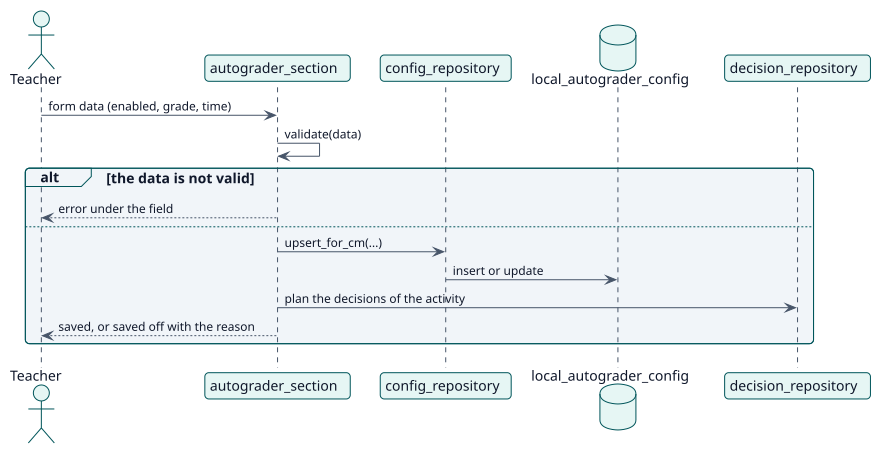

# UC-001 Configurar Autograder en una actividad — realización del diseño

| Resumen | Requisitos | Análisis | Diseño | Implementación | Pruebas |
| --- | --- | --- | --- | --- | --- |
| [Casos de uso](../../../requirements/use-case-overview.svg) | [Requisitos](../../../requirements/use-cases/configureAutograder/README.md) | [Análisis](../../../analysis/use-cases/configureAutograder/README.md) | **Diseño** | [Implementación](../../../implementation/use-cases/configureAutograder/README.md) | [Pruebas](../../../implementation/use-cases/configureAutograder/README.md#pruebas) |

Análisis: [README](../../../analysis/use-cases/configureAutograder/README.md)

## Elementos

| Elemento de diseño | Tipo | Código |
| --- | --- | --- |
| `autograder_section::validate` | servicio | `classes/form/autograder_section.php:442` |
| `autograder_section::save` | servicio | `classes/form/autograder_section.php:729` |
| `config_repository::upsert_for_cm` | servicio | `classes/local/config/config_repository.php:101` |

## Secuencia

## Contratos

| Operación | Entrada | Salida | Errores |
| --- | --- | --- | --- |
| `upsert_for_cm(cmid, courseid, enabled, grademethod, gradevalue, advancedgrading, delayseconds, userid)` | los ajustes de una actividad | el registro guardado | calificación no válida, selección ausente |

## Datos que toca

| Tabla o entidad | Operación |
| --- | --- |
| `local_autograder_config` | inserción o actualización |
| `local_autograder_decision` | inserción (decisiones planificadas) |
