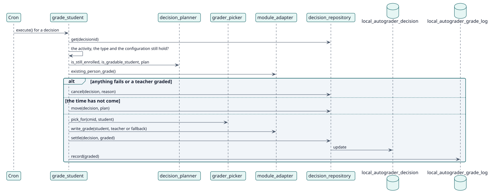

# UC-003 Calificar a un estudiante — realización del diseño

| Resumen | Requisitos | Análisis | Diseño | Implementación | Pruebas |
| --- | --- | --- | --- | --- | --- |
| [Casos de uso](../../../requirements/use-case-overview.svg) | [Requisitos](../../../requirements/use-cases/gradeStudent/README.md) | [Análisis](../../../analysis/use-cases/gradeStudent/README.md) | **Diseño** | [Implementación](../../../implementation/use-cases/gradeStudent/README.md) | [Pruebas](../../../implementation/use-cases/gradeStudent/README.md#pruebas) |

Análisis: [README](../../../analysis/use-cases/gradeStudent/README.md)

## Elementos

| Elemento de diseño | Tipo | Código |
| --- | --- | --- |
| `grade_student::execute` | tarea | `classes/task/grade_student.php:56` |
| `grader_picker::pick_for` | servicio | `classes/local/grading/grader_picker.php:56` |
| `module_adapter::write_grade` | servicio | `classes/local/module/module_adapter.php:173` |
| `decision_repository::settle` | servicio | `classes/local/decision/decision_repository.php:413` |

## Secuencia

## Contratos

| Operación | Entrada | Salida | Errores |
| --- | --- | --- | --- |
| `write_grade(userid, graderid)` | el estudiante y el docente | la calificación que se publicó | rechazo de la calificación, tipo de calificación no admitido |

## Datos que toca

| Tabla o entidad | Operación |
| --- | --- |
| `local_autograder_decision` | actualización |
| `local_autograder_grade_log` | inserción |
| `grade_grades` | actualización (mediante la actividad) |
| `logstore_standard_log` | inserción (`student_graded`) |
