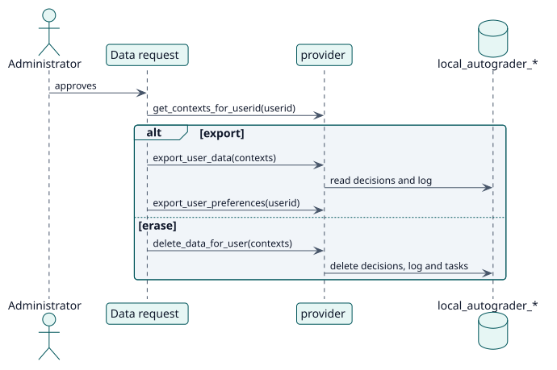

# UC-012 Exportar o eliminar datos personales — realización del diseño

| Resumen | Requisitos | Análisis | Diseño | Implementación | Pruebas |
| --- | --- | --- | --- | --- | --- |
| [Casos de uso](../../../requirements/use-case-overview.svg) | [Requisitos](../../../requirements/use-cases/managePersonalData/README.md) | [Análisis](../../../analysis/use-cases/managePersonalData/README.md) | **Diseño** | [Implementación](../../../implementation/use-cases/managePersonalData/README.md) | [Pruebas](../../../implementation/use-cases/managePersonalData/README.md#pruebas) |

Análisis: [README](../../../analysis/use-cases/managePersonalData/README.md)

## Elementos

| Elemento de diseño | Tipo | Código |
| --- | --- | --- |
| `provider::get_metadata` | proveedor | `classes/privacy/provider.php:53` |
| `provider::get_contexts_for_userid` | proveedor | `classes/privacy/provider.php:111` |
| `provider::export_user_data` | proveedor | `classes/privacy/provider.php:195` |
| `provider::export_user_preferences` | proveedor | `classes/privacy/provider.php:285` |
| `provider::delete_data_for_user` | proveedor | `classes/privacy/provider.php:318` |
| `provider::delete_data_for_all_users_in_context` | proveedor | `classes/privacy/provider.php:305` |

## Secuencia

## Contratos

| Operación | Entrada | Salida | Errores |
| --- | --- | --- | --- |
| `provider::export_user_data(approved_contextlist)` | los contextos aprobados | las decisiones y el registro del usuario en cada actividad | ninguno |
| `provider::delete_data_for_user(approved_contextlist)` | los contextos aprobados | los datos eliminados | ninguno |

## Datos que toca

| Tabla o entidad | Operación |
| --- | --- |
| `local_autograder_decision` | lectura y eliminación |
| `local_autograder_grade_log` | lectura y eliminación |
| `local_autograder_config` | eliminación (una actividad completa) |
| `user_preferences` | lectura |
