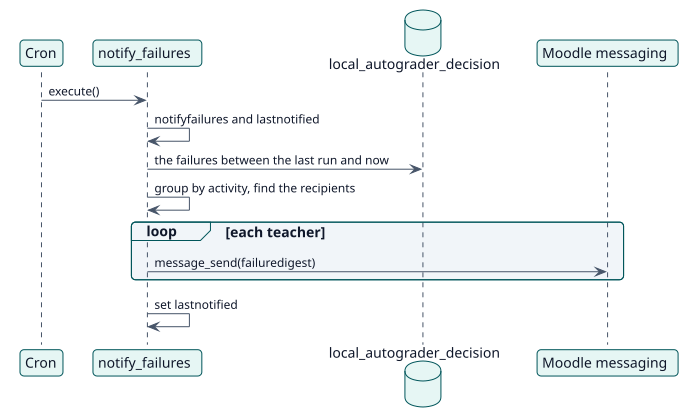

# UC-008 Avisar a los docentes de los estudiantes que no se pudieron calificar — realización del diseño

| Resumen | Requisitos | Análisis | Diseño | Implementación | Pruebas |
| --- | --- | --- | --- | --- | --- |
| [Casos de uso](../../../requirements/use-case-overview.svg) | [Requisitos](../../../requirements/use-cases/notifyFailures/README.md) | [Análisis](../../../analysis/use-cases/notifyFailures/README.md) | **Diseño** | [Implementación](../../../implementation/use-cases/notifyFailures/README.md) | [Pruebas](../../../implementation/use-cases/notifyFailures/README.md#pruebas) |

Análisis: [README](../../../analysis/use-cases/notifyFailures/README.md)

## Elementos

| Elemento de diseño | Tipo | Código |
| --- | --- | --- |
| `notify_failures::execute` | tarea | `classes/task/notify_failures.php:61` |
| `notify_failures::setting_changed` | servicio | `classes/task/notify_failures.php:115` |
| `notify_failures::recipients_for` | servicio | `classes/task/notify_failures.php:216` |
| `notify_failures::send` | servicio | `classes/task/notify_failures.php:235` |
| Message provider `failuredigest` | mensaje | `db/messages.php` |

## Secuencia

## Contratos

| Operación | Entrada | Salida | Errores |
| --- | --- | --- | --- |
| `notify_failures::execute()` | ninguna | un mensaje por docente afectado | ninguno: se omite al destinatario que no puede recibirlo |

## Datos que toca

| Tabla o entidad | Operación |
| --- | --- |
| `local_autograder_decision` | lectura |
| `config_plugins` (`lastnotified`) | actualización |
