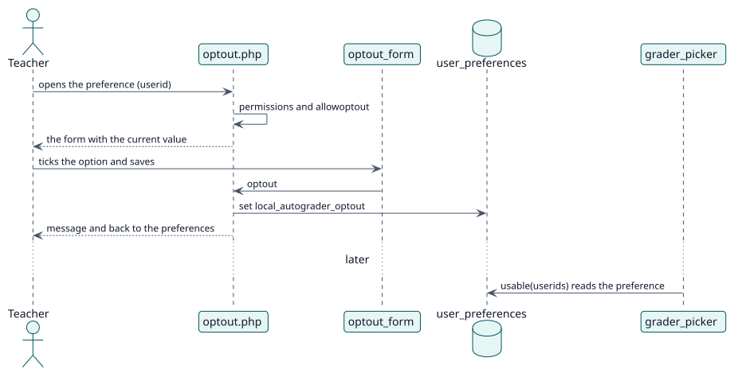

# UC-006 Excluirme de que se registren calificaciones a mi nombre — realización del diseño

| Resumen | Requisitos | Análisis | Diseño | Implementación | Pruebas |
| --- | --- | --- | --- | --- | --- |
| [Casos de uso](../../../requirements/use-case-overview.svg) | [Requisitos](../../../requirements/use-cases/optOutOfGrading/README.md) | [Análisis](../../../analysis/use-cases/optOutOfGrading/README.md) | **Diseño** | [Implementación](../../../implementation/use-cases/optOutOfGrading/README.md) | [Pruebas](../../../implementation/use-cases/optOutOfGrading/README.md#pruebas) |

Análisis: [README](../../../analysis/use-cases/optOutOfGrading/README.md)

## Elementos

| Elemento de diseño | Tipo | Código |
| --- | --- | --- |
| `optout.php` | página | `optout.php` |
| `optout_form` | formulario | `classes/form/optout_form.php` |
| `local_autograder_extend_navigation_user_settings` | gancho | `lib.php:76` |
| `local_autograder_user_preferences` | gancho | `lib.php:99` |
| `grader_picker::usable` | servicio | `classes/local/grading/grader_picker.php:96` |

## Secuencia

## Contratos

| Operación | Entrada | Salida | Errores |
| --- | --- | --- | --- |
| `optout.php?userid=` | el usuario y la opción | una redirección con un mensaje | el sitio no la ofrece, sin permiso sobre el perfil |

## Datos que toca

| Tabla o entidad | Operación |
| --- | --- |
| `user_preferences` (`local_autograder_optout`) | actualización |
