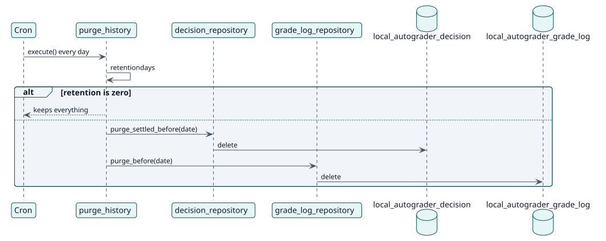

# UC-010 Eliminar el historial antiguo — realización del diseño

| Resumen | Requisitos | Análisis | Diseño | Implementación | Pruebas |
| --- | --- | --- | --- | --- | --- |
| [Casos de uso](../../../requirements/use-case-overview.svg) | [Requisitos](../../../requirements/use-cases/purgeHistory/README.md) | [Análisis](../../../analysis/use-cases/purgeHistory/README.md) | **Diseño** | [Implementación](../../../implementation/use-cases/purgeHistory/README.md) | [Pruebas](../../../implementation/use-cases/purgeHistory/README.md#pruebas) |

Análisis: [README](../../../analysis/use-cases/purgeHistory/README.md)

## Elementos

| Elemento de diseño | Tipo | Código |
| --- | --- | --- |
| `purge_history::execute` | tarea | `classes/task/purge_history.php:42` |
| `decision_repository::purge_settled_before` | servicio | `classes/local/decision/decision_repository.php:535` |
| `grade_log_repository::purge_before` | servicio | `classes/local/grading/grade_log_repository.php:129` |

## Secuencia

## Contratos

| Operación | Entrada | Salida | Errores |
| --- | --- | --- | --- |
| `purge_history::execute()` | ninguna | el número de decisiones y de entradas del registro eliminadas | ninguno |

## Datos que toca

| Tabla o entidad | Operación |
| --- | --- |
| `local_autograder_decision` | eliminación |
| `local_autograder_grade_log` | eliminación |
