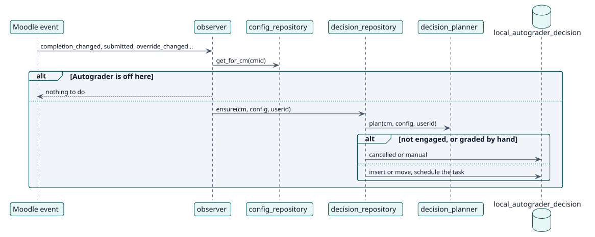

# UC-004 Reconsiderar una decisión cuando algo cambia — realización del diseño

| Resumen | Requisitos | Análisis | Diseño | Implementación | Pruebas |
| --- | --- | --- | --- | --- | --- |
| [Casos de uso](../../../requirements/use-case-overview.svg) | [Requisitos](../../../requirements/use-cases/reconsiderDecision/README.md) | [Análisis](../../../analysis/use-cases/reconsiderDecision/README.md) | **Diseño** | [Implementación](../../../implementation/use-cases/reconsiderDecision/README.md) | [Pruebas](../../../implementation/use-cases/reconsiderDecision/README.md#pruebas) |

Análisis: [README](../../../analysis/use-cases/reconsiderDecision/README.md)

## Elementos

| Elemento de diseño | Tipo | Código |
| --- | --- | --- |
| `observer::reconsider` | servicio | `classes/observer.php:318` |
| `decision_repository::ensure` | servicio | `classes/local/decision/decision_repository.php:207` |
| `decision_planner::plan` | servicio | `classes/local/decision/decision_planner.php:62` |
| Tarea `reconcile_pending` | tarea | `classes/task/reconcile_pending.php:45` |

## Secuencia

## Contratos

| Operación | Entrada | Salida | Errores |
| --- | --- | --- | --- |
| `ensure(cm, config, userid)` | la actividad, su configuración y el estudiante | la decisión, o null | ninguno: nunca lanza error por un estudiante que no ha participado |

## Datos que toca

| Tabla o entidad | Operación |
| --- | --- |
| `local_autograder_decision` | inserción, actualización |
| `task_adhoc` | inserción, borrado |
