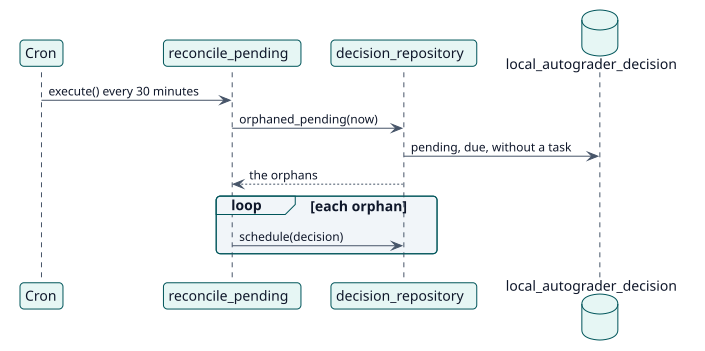

# UC-009 Poner de nuevo en cola las calificaciones que perdieron su tarea — realización del diseño

| Resumen | Requisitos | Análisis | Diseño | Implementación | Pruebas |
| --- | --- | --- | --- | --- | --- |
| [Casos de uso](../../../requirements/use-case-overview.svg) | [Requisitos](../../../requirements/use-cases/requeueLostGrades/README.md) | [Análisis](../../../analysis/use-cases/requeueLostGrades/README.md) | **Diseño** | [Implementación](../../../implementation/use-cases/requeueLostGrades/README.md) | [Pruebas](../../../implementation/use-cases/requeueLostGrades/README.md#pruebas) |

Análisis: [README](../../../analysis/use-cases/requeueLostGrades/README.md)

## Elementos

| Elemento de diseño | Tipo | Código |
| --- | --- | --- |
| `reconcile_pending::execute` | tarea | `classes/task/reconcile_pending.php:45` |
| `decision_repository::orphaned_pending` | servicio | `classes/local/decision/decision_repository.php:172` |
| `decision_repository::schedule` | servicio | `classes/local/decision/decision_repository.php:362` |

## Secuencia

## Contratos

| Operación | Entrada | Salida | Errores |
| --- | --- | --- | --- |
| `reconcile_pending::execute()` | ninguna | una tarea de calificación en cola por cada huérfana | ninguno |

## Datos que toca

| Tabla o entidad | Operación |
| --- | --- |
| `local_autograder_decision` | lectura |
| `task_adhoc` | inserción (las tareas de calificación) |
