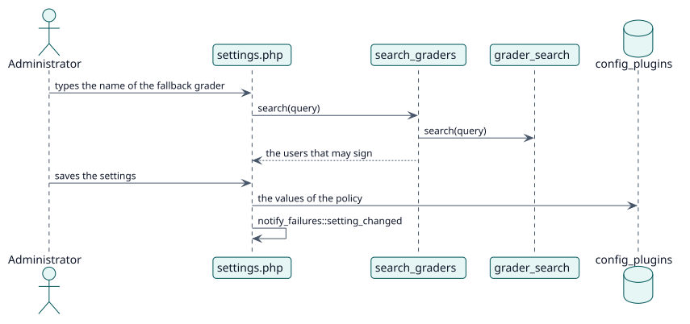

# UC-007 Establecer la política del sitio — realización del diseño

| Resumen | Requisitos | Análisis | Diseño | Implementación | Pruebas |
| --- | --- | --- | --- | --- | --- |
| [Casos de uso](../../../requirements/use-case-overview.svg) | [Requisitos](../../../requirements/use-cases/setSitePolicy/README.md) | [Análisis](../../../analysis/use-cases/setSitePolicy/README.md) | **Diseño** | [Implementación](../../../implementation/use-cases/setSitePolicy/README.md) | [Pruebas](../../../implementation/use-cases/setSitePolicy/README.md#pruebas) |

Análisis: [README](../../../analysis/use-cases/setSitePolicy/README.md)

## Elementos

| Elemento de diseño | Tipo | Código |
| --- | --- | --- |
| `settings.php` | ajuste de administración | `settings.php` |
| `fallback_grader_setting` | ajuste de administración | `classes/local/config/fallback_grader_setting.php:62` |
| `search_graders::execute` | servicio web | `classes/external/search_graders.php:73` |
| `grader_search::search` | servicio | `classes/local/config/grader_search.php:57` |
| `teacher_source::possible_graders_in` | servicio | `classes/local/grading/teacher_source.php:74` |
| `notify_failures::setting_changed` | servicio | `classes/task/notify_failures.php:115` |

## Secuencia

## Contratos

| Operación | Entrada | Salida | Errores |
| --- | --- | --- | --- |
| `local_autograder_search_graders(query)` | el texto escrito | el id y el nombre de cada usuario encontrado | sin capacidad |

## Datos que toca

| Tabla o entidad | Operación |
| --- | --- |
| `config_plugins` | actualización (los ajustes del plugin) |
