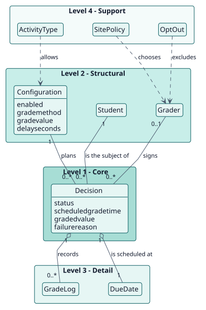
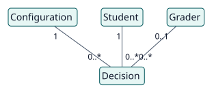
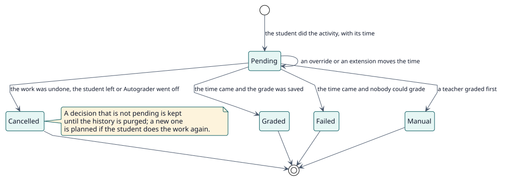

# Modelo de dominio

## Propósito

Algunas actividades se evalúan por la participación de los estudiantes y no por la calidad de su trabajo. Autograder da a esos estudiantes la calificación que un docente configuró, a tiempo, a nombre de uno de sus propios docentes, salvo que un docente los haya calificado antes. Este modelo nombra los conceptos que hay detrás de esa decisión.

## Jerarquía de entidades

La posición vertical de una entidad expresa su importancia para el objetivo del proyecto. No es herencia ni composición UML.

| Nivel | Significado | Entidades | Por qué están aquí |
| --- | --- | --- | --- |
| 1 | Núcleo: el proyecto no puede existir sin ellas | Decision | El plugin existe para decidir, para un estudiante y una actividad, si se da una calificación y cuándo. |
| 2 | Estructurales: dependen directamente del núcleo | Configuration, Student, Grader | Una decisión se deriva de la configuración de una actividad, afecta a un estudiante y la firma un calificador. |
| 3 | Detalle: cualifican o especializan el nivel 2 | GradeLog, DueDate | Describen lo que le ocurre a una decisión: cuándo vence y qué hizo cada intento. |
| 4 | Soporte: catálogos, auditoría, configuración | ActivityType, SitePolicy, OptOut | Acotan qué actividades, qué docentes y qué ajustes se aplican sin cambiar el significado de una decisión. |

## Diagramas

## Diccionario de entidades

| Entidad | Nivel | Definición | Atributos clave | Atributos omitidos y motivo |
| --- | --- | --- | --- | --- |
| Decision | 1 | Lo que Autograder ha decidido para un estudiante en una actividad: esperar, calificar, cancelar o fallar. | `status`, `scheduledgradetime`, `graderid`, `gradedvalue`, `failurereason` | Las columnas de auditoría están en el [modelo de datos](../design/data-model/data-model.svg). |
| Configuration | 2 | Los ajustes de Autograder en una actividad: si está activado, la calificación a asignar y el tiempo de espera. | `enabled`, `grademethod`, `gradevalue`, `advancedgrading`, `delayseconds` | |
| Student | 2 | Una persona matriculada con un rol que el libro de calificaciones califica y que ha hecho la actividad. | usuario de Moodle | Es el `user` de Moodle, no una tabla del plugin. |
| Grader | 2 | El docente a cuyo nombre se registra una calificación, o el calificador de reserva del sitio. | usuario de Moodle | Es el `user` de Moodle, no una tabla del plugin. |
| GradeLog | 3 | La traza de auditoría de cada intento de calificación, separada de la decisión. | `outcome`, `message`, `graderid`, `gradevalue` | |
| DueDate | 3 | El momento en que vence una decisión: la fecha base más el tiempo de espera. | `baselineduedate`, `duedatereason`, `scheduledgradetime` | Es un conjunto de columnas de la decisión. |
| ActivityType | 4 | Una clase de actividad que puede usar Autograder: la que recibe el trabajo de los estudiantes y tiene una calificación que otorga un docente. | el nombre del tipo | Los tipos que el sitio permite son un ajuste del sitio, no una tabla; los tipos que cumplen la regla se calculan a partir de los plugins instalados. |
| SitePolicy | 4 | Los ajustes del sitio: roles de docente, selección del docente, calificador de reserva, notificaciones e historial. | `teacher_source_mode`, `tiebreak`, `fallback_grader` | Son ajustes del plugin. |
| OptOut | 4 | La preferencia de un docente de que no se registren calificaciones a su nombre. | preferencia de usuario | Es una preferencia de usuario, no una tabla. |

## Reglas de negocio

| ID | Regla | Entidades | Fuente |
| --- | --- | --- | --- |
| RN-001 | Un estudiante se califica solo después de hacer la actividad: al cumplir sus condiciones de finalización, ignorando las que piden una calificación, o al entregar algo cuando no hay seguimiento de finalización. | Student, Decision | `decision_planner::engagement` |
| RN-002 | Una calificación vence en la fecha base más el tiempo de espera. La base es la fecha de cierre, una excepción de usuario, la más tardía de las excepciones de grupo o, sin fecha de cierre, el momento en que el estudiante terminó. | DueDate | `due_date_calculator::calculate` |
| RN-003 | Una calificación puesta por un docente siempre gana: Autograder nunca la sobrescribe y un estudiante calificado no se vuelve a calificar. | Decision | `grade_student::execute` |
| RN-004 | La calificación se registra a nombre de un docente del estudiante que pueda calificar la actividad y ver al estudiante; se prefiere al docente que comparte más grupos. Sin docente, firma el calificador de reserva; sin este, la calificación falla. | Grader | `grader_picker::pick_for` |
| RN-005 | Todo lo que importa se comprueba de nuevo cuando vence la calificación: la actividad, su tipo, su configuración, la matriculación y el rol del estudiante. | Decision | `grade_student::execute` |
| RN-006 | Hay una decisión por estudiante y actividad; una decisión calificada, fallida, manual o cancelada es definitiva hasta que se planifica una nueva. | Decision | `decision_repository::ensure` |
| RN-007 | Desactivar Autograder en una actividad, o el tipo de la actividad en el sitio, cancela las calificaciones que siguen pendientes. | Configuration, ActivityType | `cancel_module`, `eligibility::set_module_type_enabled` |
| RN-008 | Un cuestionario que se califica solo conserva su propia calificación: Autograder solo califica mientras una pregunta espera corrección manual y devuelve el libro de calificaciones después. | Decision | `observer::hand_back` |
| RN-009 | Las decisiones terminadas y las entradas del registro más antiguas que el ajuste de retención se eliminan a diario. | Decision, GradeLog | `purge_history` |
| RN-010 | Un tipo de actividad cumple la regla cuando tiene calificación y, además, declara el propósito «evaluación» o define la capacidad `mod/<tipo>:grade`. Un tipo que deja de cumplirla se retira de los habilitados y se cancela lo que estaba pendiente para él. | ActivityType | `eligibility::is_module_type_supported`, `eligibility::withdraw_unsupported_types` |

## Ciclos de vida

### Decisión

