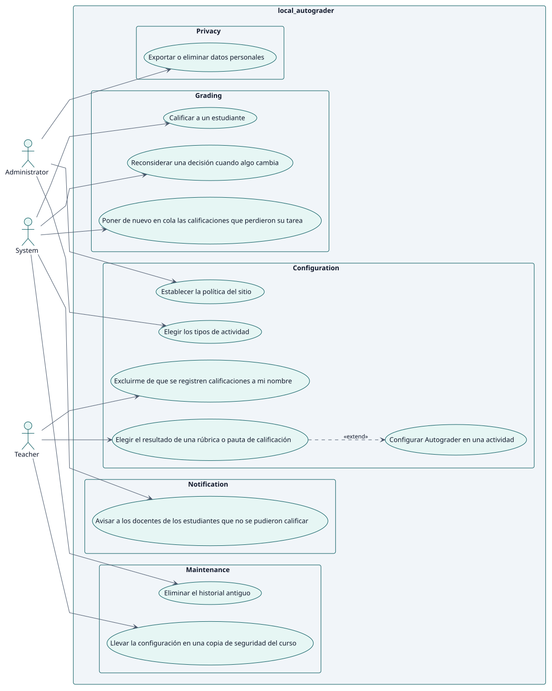
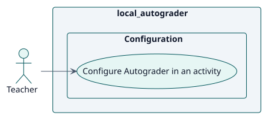
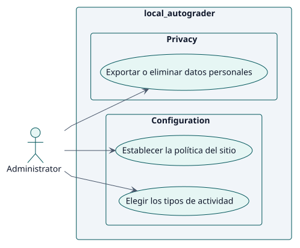
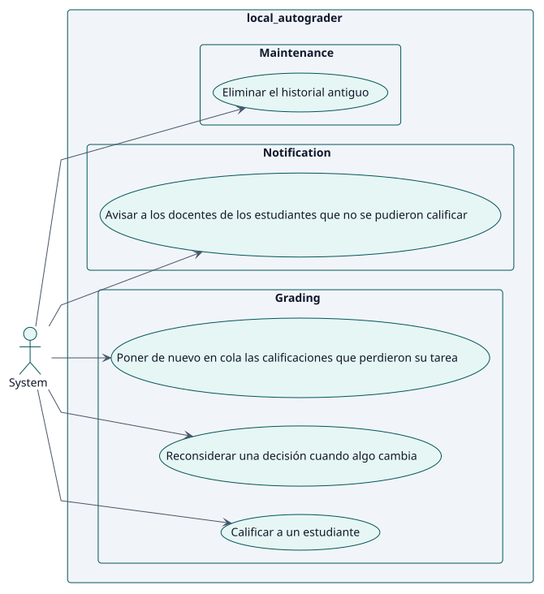

# Requisitos

## Índice

- [Actores](./actors.md)
- [Catálogo de requisitos](./requirements.md)

## Casos de uso

| ID | Caso de uso | Actor | Paquete | Requisito | Análisis | Diseño | Implementación | Estado |
| --- | --- | --- | --- | --- | --- | --- | --- | --- |
| UC-001 | [Configurar Autograder en una actividad](./use-cases/configureAutograder/README.md) | Docente | Configuración | RF-001 | [ficha](../analysis/use-cases/configureAutograder/README.md) | [ficha](../design/use-cases/configureAutograder/README.md) | [ficha](../implementation/use-cases/configureAutograder/README.md) | borrador |
| UC-002 | [Elegir los tipos de actividad](./use-cases/chooseActivityTypes/README.md) | Administrador | Configuración | RF-002 | [ficha](../analysis/use-cases/chooseActivityTypes/README.md) | [ficha](../design/use-cases/chooseActivityTypes/README.md) | [ficha](../implementation/use-cases/chooseActivityTypes/README.md) | borrador |
| UC-003 | [Calificar a un estudiante](./use-cases/gradeStudent/README.md) | Sistema | Calificación | RF-003 | [ficha](../analysis/use-cases/gradeStudent/README.md) | [ficha](../design/use-cases/gradeStudent/README.md) | [ficha](../implementation/use-cases/gradeStudent/README.md) | borrador |
| UC-004 | [Reconsiderar una decisión cuando algo cambia](./use-cases/reconsiderDecision/README.md) | Sistema | Calificación | RF-004 | [ficha](../analysis/use-cases/reconsiderDecision/README.md) | [ficha](../design/use-cases/reconsiderDecision/README.md) | [ficha](../implementation/use-cases/reconsiderDecision/README.md) | borrador |

### Diagrama de casos de uso

### Por actor

#### Docente

#### Administrador

#### Sistema

