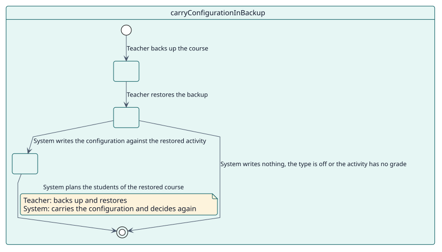
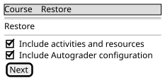

# UC-011 Llevar la configuración en una copia de seguridad del curso

| Resumen | Requisitos | Análisis | Diseño | Implementación | Pruebas |
| --- | --- | --- | --- | --- | --- |
| [Casos de uso](../../use-case-overview.svg) | **Requisitos** | [Análisis](../../../analysis/use-cases/carryConfigurationInBackup/README.md) | [Diseño](../../../design/use-cases/carryConfigurationInBackup/README.md) | [Implementación](../../../implementation/use-cases/carryConfigurationInBackup/README.md) | [Pruebas](../../../implementation/use-cases/carryConfigurationInBackup/README.md#pruebas) |

## Información del caso de uso

| Campo | Valor |
| --- | --- |
| Actor | Docente |
| Paquete | Maintenance |
| Objetivo | Copiar y restaurar una actividad con su configuración de Autograder. |
| Tipo | Primario, esencial |
| Nivel | Objetivo de usuario |
| Requisito | RF-011 |
| Entidades del dominio | Configuration, Decision |

## Contexto

La configuración que eligió un docente forma parte de la actividad y viaja con ella cuando el curso se copia, se duplica o se importa. Las decisiones y el registro no: dependen de las finalizaciones, las entregas y las matriculaciones del curso, de modo que el curso restaurado decide de nuevo.

## Precondiciones

- El usuario puede copiar y restaurar el curso.

## Postcondiciones

- Éxito: la actividad restaurada tiene su configuración y Autograder decide lo que debe a cada estudiante.
- Fallo: una configuración que no puede funcionar en la actividad restaurada vuelve desactivada.

## Flujo principal

| Paso | Actor | Sistema |
| --- | --- | --- |
| 1 | Copia el curso o la actividad. | Añade la configuración de cada actividad a sus datos; deja fuera las decisiones y el registro. |
| 2 | Restaura la copia. | Retiene la configuración hasta que la actividad, su elemento de calificación y su formulario de calificación existen. |
| 3 |  | Escribe la configuración sobre la actividad restaurada, con la elección de una rúbrica o pauta trasladada a los criterios restaurados. |
| 4 |  | Planifica a los estudiantes del curso restaurado. |

## Flujos alternativos

| ID | Empieza en el paso | Condición | Comportamiento | Termina |
| --- | --- | --- | --- | --- |
| A1 | 3 | El tipo de la actividad no está habilitado en este sitio. | No escribe ninguna configuración. | Fin |
| A2 | 3 | La actividad volvió sin calificación. | No escribe ninguna configuración. | Fin |
| A3 | 3 | La calificación o la elección no se pudieron trasladar. | Escribe la configuración desactivada, de modo que el docente encuentre el aviso del formulario. | Paso 4 |

## Reglas de negocio

| ID | Regla |
| --- | --- |
| RN-014 | La configuración viaja en una copia de seguridad del curso y las decisiones y el registro no. Se restaura activada solo donde hay con qué calificar, y los estudiantes se deciden de nuevo. |

## Especificación

Fuente de verdad del comportamiento: [specification.puml](./specification.puml)

## Prototipos

