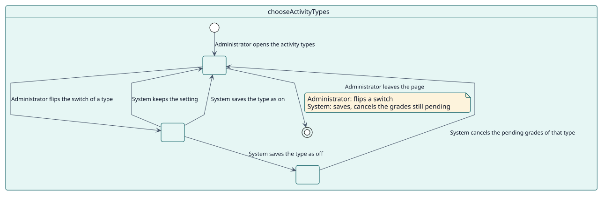
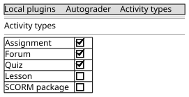

# UC-002 Elegir los tipos de actividad

| Resumen | Requisitos | Análisis | Diseño | Implementación | Pruebas |
| --- | --- | --- | --- | --- | --- |
| [Casos de uso](../../use-case-overview.svg) | **Requisitos** | [Análisis](../../../analysis/use-cases/chooseActivityTypes/README.md) | [Diseño](../../../design/use-cases/chooseActivityTypes/README.md) | [Implementación](../../../implementation/use-cases/chooseActivityTypes/README.md) | [Pruebas](../../../implementation/use-cases/chooseActivityTypes/README.md#pruebas) |

## Información del caso de uso

| Campo | Valor |
| --- | --- |
| Actor | Administrador |
| Paquete | Configuration |
| Objetivo | Decidir qué clases de actividad pueden usar Autograder. |
| Tipo | Primario, esencial |
| Nivel | Objetivo de usuario |
| Requisito | RF-002 |
| Entidades del dominio | ActivityType, Configuration, Decision |

## Contexto

El sitio decide qué tipos de actividad puede calificar Autograder, entre los instalados que reciben el trabajo de los estudiantes y tienen una calificación que otorga un docente. Un tipo desactivado oculta los ajustes y detiene las calificaciones que esperaban.

## Precondiciones

- El administrador tiene `local/autograder:manage`.

## Postcondiciones

- Éxito: el tipo queda guardado como activado o desactivado y, si se desactiva, sus calificaciones pendientes se cancelan.
- Fallo: el ajuste se queda como estaba.

## Flujo principal

| Paso | Actor | Sistema |
| --- | --- | --- |
| 1 | Abre **Tipos de actividad** desde los ajustes del plugin. | Lista los tipos instalados que cumplen RN-010, con lo que Autograder lee en cada uno y su interruptor. |
| 2 | Cambia el interruptor de un tipo. | Lo guarda al instante: la página envía el interruptor y muestra un mensaje. |
| 3 |  | Cuando el tipo se desactiva, encola la cancelación de las calificaciones pendientes de sus actividades. |
| 4 |  | Muestra un mensaje con el resultado. |

## Flujos alternativos

| ID | Empieza en el paso | Condición | Comportamiento | Termina |
| --- | --- | --- | --- | --- |
| A1 | 2 | El tipo no puede calificarse. | Deja el ajuste como está. | Paso 1 |

## Reglas de negocio

| ID | Regla |
| --- | --- |
| RN-007 | Desactivar en el sitio el tipo de una actividad cancela las calificaciones que siguen pendientes. |
| RN-010 | Un tipo se ofrece únicamente cuando tiene calificación y, además, declara el propósito «evaluación» o define la capacidad `mod/<tipo>:grade`. Un plugin instalado que la cumple se ofrece sin ningún cambio. |

## Especificación

Fuente de verdad del comportamiento: [specification.puml](./specification.puml)

## Prototipos

