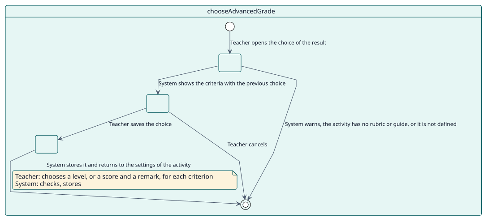
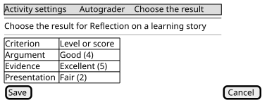

# UC-005 Elegir el resultado de una rúbrica o pauta de calificación

| Resumen | Requisitos | Análisis | Diseño | Implementación | Pruebas |
| --- | --- | --- | --- | --- | --- |
| [Casos de uso](../../use-case-overview.svg) | **Requisitos** | [Análisis](../../../analysis/use-cases/chooseAdvancedGrade/README.md) | [Diseño](../../../design/use-cases/chooseAdvancedGrade/README.md) | [Implementación](../../../implementation/use-cases/chooseAdvancedGrade/README.md) | [Pruebas](../../../implementation/use-cases/chooseAdvancedGrade/README.md#pruebas) |

## Información del caso de uso

| Campo | Valor |
| --- | --- |
| Actor | Docente |
| Paquete | Configuration |
| Objetivo | Elegir el nivel de cada criterio de la rúbrica, o la puntuación y el comentario de cada criterio de la pauta de calificación, que da Autograder. |
| Tipo | Primario, esencial |
| Nivel | Objetivo de usuario |
| Requisito | RF-006 |
| Entidades del dominio | Configuration, Decision |

## Contexto

Una rúbrica o una pauta de calificación no da un único número. El docente rellena el formulario una vez, como si calificara a un estudiante, y Autograder da ese resultado a cada estudiante que califica en la actividad.

## Precondiciones

- El docente tiene `local/autograder:configure` en la actividad.
- La actividad se califica con una rúbrica o una pauta de calificación que ya está definida.

## Postcondiciones

- Éxito: el resultado elegido queda guardado con la configuración de la actividad.
- Fallo: no cambia nada y el docente vuelve a los ajustes de la actividad con un mensaje.

## Flujo principal

| Paso | Actor | Sistema |
| --- | --- | --- |
| 1 | Abre la elección del resultado desde la sección Autograder de los ajustes de la actividad. | Comprueba la capacidad, el método de calificación y que el formulario está definido, y muestra los criterios con la elección anterior. |
| 2 | Elige un nivel, o una puntuación y un comentario, para cada criterio. | Valida las respuestas con la definición del formulario. |
| 3 | Guarda. | Almacena la elección, registra que la configuración se actualizó y vuelve a los ajustes de la actividad con un mensaje. |

## Flujos alternativos

| ID | Empieza en el paso | Condición | Comportamiento | Termina |
| --- | --- | --- | --- | --- |
| A1 | 1 | La actividad no se califica con una rúbrica ni con una pauta de calificación. | Avisa y vuelve a los ajustes de la actividad. | Fin |
| A2 | 1 | La rúbrica o la pauta de calificación todavía no está definida. | Envía al docente a definirla, con un mensaje. | Fin |
| A3 | 2 | El docente cancela. | Vuelve a los ajustes sin guardar. | Fin |

## Reglas de negocio

| ID | Regla |
| --- | --- |
| RN-017 | El resultado de una rúbrica o de una pauta de calificación se usa solo mientras sigue coincidiendo con la definición: cada criterio respondido y cada respuesta una que la definición ofrece. |

## Especificación

Fuente de verdad del comportamiento: [specification.puml](./specification.puml)

## Prototipos

