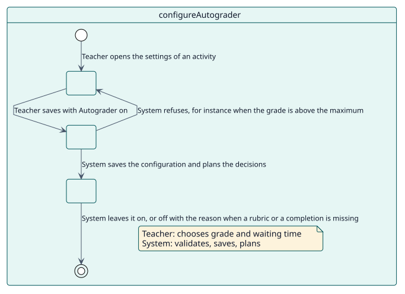
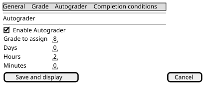

# UC-001 Configurar Autograder en una actividad

| Resumen | Requisitos | Análisis | Diseño | Implementación | Pruebas |
| --- | --- | --- | --- | --- | --- |
| [Casos de uso](../../use-case-overview.svg) | **Requisitos** | [Análisis](../../../analysis/use-cases/configureAutograder/README.md) | [Diseño](../../../design/use-cases/configureAutograder/README.md) | [Implementación](../../../implementation/use-cases/configureAutograder/README.md) | [Pruebas](../../../implementation/use-cases/configureAutograder/README.md#pruebas) |

## Información del caso de uso

| Campo | Valor |
| --- | --- |
| Actor | Docente |
| Paquete | Configuration |
| Objetivo | Activar Autograder en una actividad y elegir la calificación y el tiempo de espera. |
| Tipo | Primario, esencial |
| Nivel | Objetivo de usuario |
| Requisito | RF-001 |
| Entidades del dominio | Configuration, Decision |

## Contexto

Un docente decide, actividad por actividad, si los estudiantes que participaron se califican automáticamente, con qué calificación y cuánto después de la fecha límite.

## Precondiciones

- El docente tiene `local/autograder:configure` en la actividad.
- El tipo de la actividad está habilitado en el sitio y la actividad se califica.

## Postcondiciones

- Éxito: la configuración queda guardada y las decisiones de la actividad se planifican.
- Fallo: no se guarda nada y el formulario muestra qué corregir, o Autograder queda desactivado con el motivo.

## Flujo principal

| Paso | Actor | Sistema |
| --- | --- | --- |
| 1 | Abre los ajustes de la actividad y activa **Activar Autograder**. | Muestra el campo de calificación que corresponde al tipo de calificación de la actividad. |
| 2 | Elige la calificación a asignar y el tiempo de espera, y guarda. | Valida la calificación, el máximo y el tiempo. |
| 3 |  | Guarda la configuración en `local_autograder_config` y lanza el evento de creación o de actualización. |
| 4 |  | Planifica la decisión de cada estudiante que ya hizo la actividad. |

## Flujos alternativos

| ID | Empieza en el paso | Condición | Comportamiento | Termina |
| --- | --- | --- | --- | --- |
| A1 | 2 | La calificación está vacía, es negativa o supera el máximo. | Muestra el error bajo el campo; no se guarda nada. | Paso 1 |
| A2 | 3 | La actividad usa una rúbrica o una guía de evaluación sin selección. | Guarda Autograder desactivado y enlaza a la selección. | Paso 4 |
| A3 | 3 | El tipo necesita finalización y no tiene condición que el estudiante pueda cumplir. | Guarda Autograder desactivado y explica el motivo. | Paso 4 |

## Reglas de negocio

| ID | Regla |
| --- | --- |
| RN-007 | Desactivar Autograder en una actividad cancela las calificaciones que siguen pendientes. |

## Especificación

Fuente de verdad del comportamiento: [specification.puml](./specification.puml)

## Prototipos

