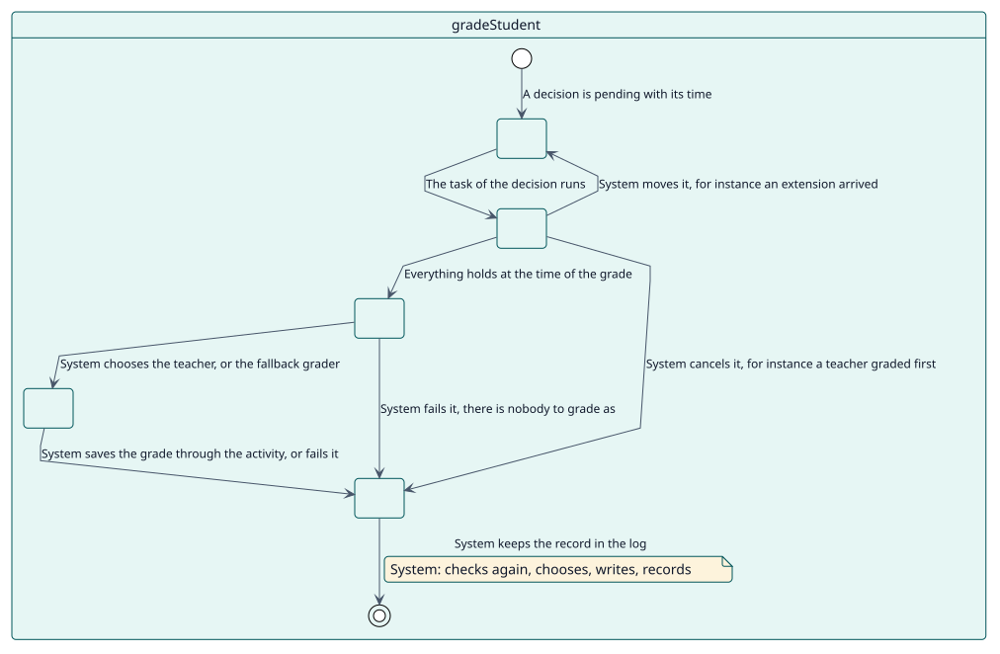
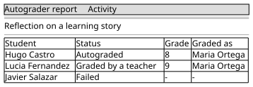

# UC-003 Calificar a un estudiante

| Resumen | Requisitos | Análisis | Diseño | Implementación | Pruebas |
| --- | --- | --- | --- | --- | --- |
| [Casos de uso](../../use-case-overview.svg) | **Requisitos** | [Análisis](../../../analysis/use-cases/gradeStudent/README.md) | [Diseño](../../../design/use-cases/gradeStudent/README.md) | [Implementación](../../../implementation/use-cases/gradeStudent/README.md) | [Pruebas](../../../implementation/use-cases/gradeStudent/README.md#pruebas) |

## Información del caso de uso

| Campo | Valor |
| --- | --- |
| Actor | Sistema |
| Paquete | Grading |
| Objetivo | Dar la calificación configurada en el momento en que vence, a nombre de uno de los docentes del estudiante. |
| Tipo | Primario, esencial |
| Nivel | Objetivo de usuario |
| Requisito | RF-003 |
| Entidades del dominio | Decision, Configuration, Student, Grader, GradeLog |

## Contexto

Cada decisión tiene su propia tarea ad hoc, programada para el momento en que vence. Cuando se ejecuta, lee de nuevo todas las condiciones y da la calificación, mueve la decisión, la cancela o la marca como fallida.

## Precondiciones

- La decisión está pendiente y su tarea está encolada.
- Cron se ejecuta.

## Postcondiciones

- Éxito: la calificación se guarda mediante la actividad a nombre de un docente o del calificador de reserva, y el intento queda registrado.
- Fallo: la decisión se cancela, se mueve o falla con su motivo, y no se sobrescribe nada.

## Flujo principal

| Paso | Actor | Sistema |
| --- | --- | --- |
| 1 |  | Lee la decisión y comprueba que la actividad, su tipo, su configuración, la matriculación y el rol del estudiante siguen vigentes. |
| 2 |  | Planifica de nuevo con datos actuales y comprueba que ningún docente ha calificado al estudiante. |
| 3 |  | Elige al docente; si no hay ninguno, usa el calificador de reserva. |
| 4 |  | Escribe la calificación mediante el adaptador de la actividad. |
| 5 |  | Marca la decisión como calificada, registra el intento en el registro y lanza `student_graded`. |

## Flujos alternativos

| ID | Empieza en el paso | Condición | Comportamiento | Termina |
| --- | --- | --- | --- | --- |
| A1 | 1 | La actividad, el tipo, la configuración, la matriculación o el rol ya no son vigentes. | Cancela la decisión con el motivo. | Fin |
| A2 | 2 | Un docente calificó al estudiante. | Cancela la decisión como manual. | Fin |
| A3 | 2 | Una prórroga movió el momento. | Mueve la decisión y vuelve más tarde. | Fin |
| A4 | 3 | No hay docente ni calificador de reserva. | Marca la decisión como fallida con `no_grader`. | Fin |
| A5 | 4 | El docente es rechazado. | Lo intenta una vez con el calificador de reserva; si también es rechazado, falla con `grade_write_failed`. | Fin |

## Reglas de negocio

| ID | Regla |
| --- | --- |
| RN-003 | Una calificación puesta por un docente siempre gana. |
| RN-004 | La calificación se registra a nombre de un docente del estudiante que pueda calificar; si no, del calificador de reserva. |
| RN-005 | Todo lo que importa se comprueba de nuevo cuando vence la calificación. |

## Especificación

Fuente de verdad del comportamiento: [specification.puml](./specification.puml)

## Prototipos

