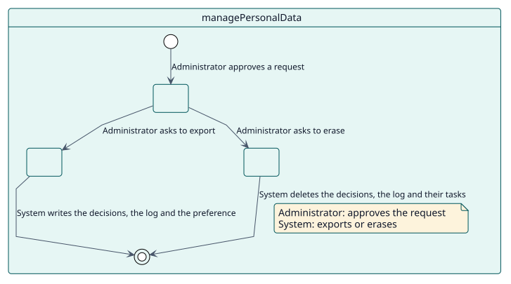
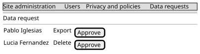

# UC-012 Exportar o eliminar datos personales

| Resumen | Requisitos | Análisis | Diseño | Implementación | Pruebas |
| --- | --- | --- | --- | --- | --- |
| [Casos de uso](../../use-case-overview.svg) | **Requisitos** | [Análisis](../../../analysis/use-cases/managePersonalData/README.md) | [Diseño](../../../design/use-cases/managePersonalData/README.md) | [Implementación](../../../implementation/use-cases/managePersonalData/README.md) | [Pruebas](../../../implementation/use-cases/managePersonalData/README.md#pruebas) |

## Información del caso de uso

| Campo | Valor |
| --- | --- |
| Actor | Administrador |
| Paquete | Privacy |
| Objetivo | Atender la solicitud de un usuario de exportar o eliminar lo que Autograder almacena sobre él. |
| Tipo | Primario, esencial |
| Nivel | Objetivo de usuario |
| Requisito | RF-012 |
| Entidades del dominio | Decision, GradeLog, Configuration, OptOut |

## Contexto

Autograder almacena, por cada estudiante y actividad, la decisión y el registro de la calificación, y por cada docente las calificaciones registradas a su nombre y su preferencia de exclusión. Implementa la API de privacidad de Moodle, que usan las solicitudes de datos del sitio.

## Precondiciones

- El administrador o el delegado de protección de datos puede gestionar solicitudes de datos.

## Postcondiciones

- Éxito: los datos del usuario se exportan, o se eliminan donde están almacenados.
- Fallo: un contexto no admitido se ignora.

## Flujo principal

| Paso | Actor | Sistema |
| --- | --- | --- |
| 1 | Aprueba una solicitud de un usuario. | Enumera las actividades donde Autograder guarda datos sobre el usuario. |
| 2 | Exporta los datos. | Escribe las decisiones y el registro del usuario en cada actividad, y su preferencia de exclusión. |
| 3 | Elimina los datos. | Elimina las decisiones y el registro del usuario, y las tareas que hay detrás; para una actividad completa, también su configuración. |

## Flujos alternativos

| ID | Empieza en el paso | Condición | Comportamiento | Termina |
| --- | --- | --- | --- | --- |
| A1 | 2 | El contexto no es una actividad. | Lo ignora. | Fin |

## Reglas de negocio

| ID | Regla |
| --- | --- |
| RN-015 | Las decisiones y el registro de un usuario pueden exportarse y eliminarse mediante la API de privacidad; eliminar una actividad completa elimina también su configuración. |

## Especificación

Fuente de verdad del comportamiento: [specification.puml](./specification.puml)

## Prototipos

