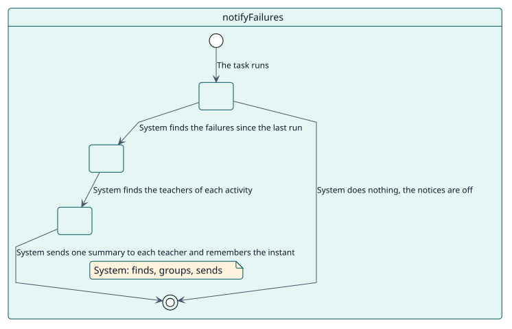
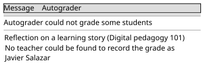

# UC-008 Avisar a los docentes de los estudiantes que no se pudieron calificar

| Resumen | Requisitos | Análisis | Diseño | Implementación | Pruebas |
| --- | --- | --- | --- | --- | --- |
| [Casos de uso](../../use-case-overview.svg) | **Requisitos** | [Análisis](../../../analysis/use-cases/notifyFailures/README.md) | [Diseño](../../../design/use-cases/notifyFailures/README.md) | [Implementación](../../../implementation/use-cases/notifyFailures/README.md) | [Pruebas](../../../implementation/use-cases/notifyFailures/README.md#pruebas) |

## Información del caso de uso

| Campo | Valor |
| --- | --- |
| Actor | Sistema |
| Paquete | Notification |
| Objetivo | Enviar a cada docente afectado un resumen de los estudiantes que Autograder no pudo calificar desde la última vez. |
| Tipo | Primario, esencial |
| Nivel | Objetivo de usuario |
| Requisito | RF-005 |
| Entidades del dominio | Decision, Configuration, Grader |

## Contexto

Una calificación falla cuando un estudiante vence, mientras nadie mira. Sin un aviso, el docente se entera cuando alguien pregunta por qué un estudiante no tiene calificación. La tarea se ejecuta de forma predeterminada cada lunes por la mañana, un horario que el administrador puede cambiar, y envía un resumen solo cuando el sitio activó los avisos.

## Precondiciones

- Los avisos de fallos están activados en los ajustes.

## Postcondiciones

- Éxito: cada docente afectado recibe un mensaje con las actividades que fallaron desde la última ejecución, y se recuerda hasta dónde se llegó.
- Fallo: un fallo que cae entre dos ejecuciones se informa en la siguiente.

## Flujo principal

| Paso | Actor | Sistema |
| --- | --- | --- |
| 1 |  | Se ejecuta y lee el punto al que llegó la última ejecución. |
| 2 |  | Busca las decisiones que fallaron después de ese punto y antes de ahora. |
| 3 |  | Las agrupa por actividad y averigua quién está matriculado en el curso y puede configurar Autograder en él. |
| 4 | Recibe el mensaje por el canal que prefiera. | Envía un mensaje por docente, con un enlace a los ajustes de cada actividad y el motivo de cada fallo. |
| 5 |  | Recuerda el instante de la ejecución. |

## Flujos alternativos

| ID | Empieza en el paso | Condición | Comportamiento | Termina |
| --- | --- | --- | --- | --- |
| A1 | 1 | Los avisos están desactivados. | No hace nada. | Fin |
| A2 | 1 | La tarea nunca se ejecutó y el ajuste no se guardó desde la administración. | Empieza el recuento en este momento y no envía nada. | Fin |
| A3 | 4 | Un destinatario está eliminado o suspendido. | No envía nada a ese usuario. | Paso 5 |
| A4 | 4 | Un mensaje enumera más de veinte actividades. | Enumera veinte y resume el resto. | Paso 5 |

## Reglas de negocio

| ID | Regla |
| --- | --- |
| RN-012 | Cada fallo se informa una vez, agrupado por actividad, a las personas matriculadas en el curso que pueden configurar Autograder en la actividad. |
| RN-009 | Las decisiones terminadas más antiguas que el ajuste de retención se eliminan a diario, de modo que una retención menor que el intervalo de esta tarea eliminaría fallos antes de informarlos. |

## Especificación

Fuente de verdad del comportamiento: [specification.puml](./specification.puml)

## Prototipos

