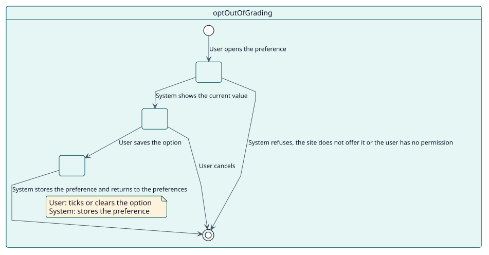
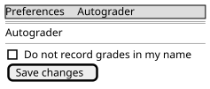

# UC-006 Excluirme de que se registren calificaciones a mi nombre

| Resumen | Requisitos | Análisis | Diseño | Implementación | Pruebas |
| --- | --- | --- | --- | --- | --- |
| [Casos de uso](../../use-case-overview.svg) | **Requisitos** | [Análisis](../../../analysis/use-cases/optOutOfGrading/README.md) | [Diseño](../../../design/use-cases/optOutOfGrading/README.md) | [Implementación](../../../implementation/use-cases/optOutOfGrading/README.md) | [Pruebas](../../../implementation/use-cases/optOutOfGrading/README.md#pruebas) |

## Información del caso de uso

| Campo | Valor |
| --- | --- |
| Actor | Docente |
| Paquete | Configuration |
| Objetivo | Pedir que Autograder no registre nunca una calificación a nombre del usuario. |
| Tipo | Primario, esencial |
| Nivel | Objetivo de usuario |
| Requisito | RF-007 |
| Entidades del dominio | OptOut, Grader, SitePolicy |

## Contexto

Autograder registra cada calificación a nombre de un docente del estudiante. Un docente que no desea firmar calificaciones dadas por Autograder puede indicarlo en sus preferencias, cuando el sitio lo ofrece.

## Precondiciones

- El sitio permite la exclusión.
- El usuario puede editar su propio perfil, o el del usuario indicado, con `moodle/user:editownprofile` o `moodle/user:editprofile`.

## Postcondiciones

- Éxito: la preferencia queda guardada y el usuario deja de ser elegido para firmar calificaciones.
- Fallo: la página se rechaza y la preferencia queda como estaba.

## Flujo principal

| Paso | Actor | Sistema |
| --- | --- | --- |
| 1 | Abre **Autograder** desde las preferencias del usuario. | Comprueba los permisos y que el sitio ofrece la preferencia, y muestra el formulario con el valor actual. |
| 2 | Marca o desmarca la opción y guarda. | Almacena la preferencia y vuelve a las preferencias con un mensaje. |
| 3 |  | A partir de ese momento, deja al usuario fuera de los docentes que pueden firmar una calificación, mientras el sitio permita la exclusión. |

## Flujos alternativos

| ID | Empieza en el paso | Condición | Comportamiento | Termina |
| --- | --- | --- | --- | --- |
| A1 | 1 | El sitio no ofrece la preferencia. | Rechaza la página con un mensaje, aunque se escriba su dirección. | Fin |
| A2 | 1 | El usuario no tiene permiso sobre ese perfil. | Rechaza la página. | Fin |
| A3 | 2 | El usuario cancela. | Vuelve a las preferencias sin guardar. | Fin |

## Reglas de negocio

| ID | Regla |
| --- | --- |
| RN-011 | Un docente que se excluyó nunca es elegido para firmar una calificación, pero solo mientras el sitio permita la exclusión. |

## Especificación

Fuente de verdad del comportamiento: [specification.puml](./specification.puml)

## Prototipos

