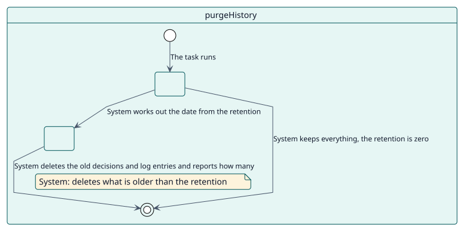
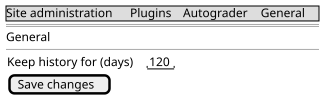

# UC-010 Eliminar el historial antiguo

| Resumen | Requisitos | Análisis | Diseño | Implementación | Pruebas |
| --- | --- | --- | --- | --- | --- |
| [Casos de uso](../../use-case-overview.svg) | **Requisitos** | [Análisis](../../../analysis/use-cases/purgeHistory/README.md) | [Diseño](../../../design/use-cases/purgeHistory/README.md) | [Implementación](../../../implementation/use-cases/purgeHistory/README.md) | [Pruebas](../../../implementation/use-cases/purgeHistory/README.md#pruebas) |

## Información del caso de uso

| Campo | Valor |
| --- | --- |
| Actor | Sistema |
| Paquete | Maintenance |
| Objetivo | Eliminar las decisiones terminadas y las entradas del registro que son más antiguas que la retención del sitio. |
| Tipo | Primario, esencial |
| Nivel | Objetivo de usuario |
| Requisito | RF-010 |
| Entidades del dominio | Decision, GradeLog, SitePolicy |

## Contexto

Las decisiones y el registro de calificaciones crecen con cada estudiante y actividad. El sitio elige cuántos días los conserva y una tarea elimina los más antiguos una vez al día. Las decisiones pendientes nunca se eliminan.

## Precondiciones

- La retención es mayor que cero.

## Postcondiciones

- Éxito: las decisiones terminadas y las entradas del registro más antiguas que la retención ya no existen.
- Fallo: con una retención de cero, no se elimina nada.

## Flujo principal

| Paso | Actor | Sistema |
| --- | --- | --- |
| 1 |  | Se ejecuta cada día a las 03:30 y lee la retención en días. |
| 2 |  | Elimina las decisiones terminadas (calificadas, canceladas, fallidas o manuales) anteriores a esa fecha, por lotes. |
| 3 |  | Elimina las entradas del registro anteriores a esa fecha. |
| 4 |  | Indica cuántas eliminó. |

## Flujos alternativos

| ID | Empieza en el paso | Condición | Comportamiento | Termina |
| --- | --- | --- | --- | --- |
| A1 | 1 | La retención es cero. | Conserva todo y termina. | Fin |

## Reglas de negocio

| ID | Regla |
| --- | --- |
| RN-009 | Las decisiones terminadas y las entradas del registro más antiguas que el ajuste de retención se eliminan a diario; las decisiones pendientes nunca se eliminan. |

## Especificación

Fuente de verdad del comportamiento: [specification.puml](./specification.puml)

## Prototipos

