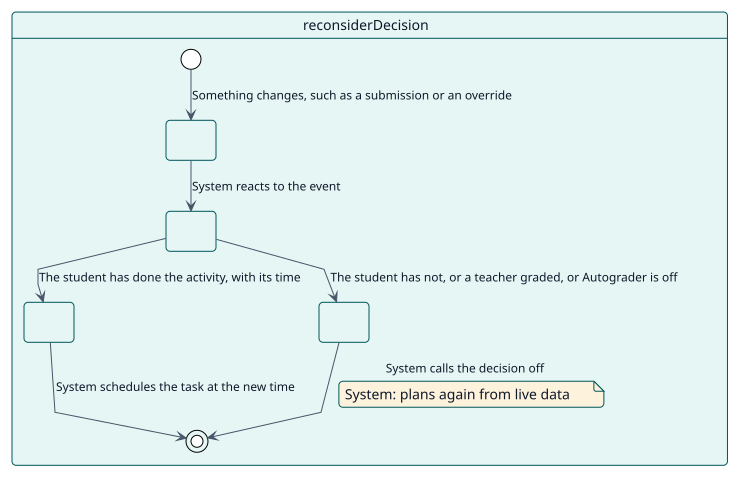
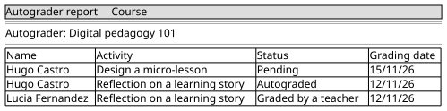

# UC-004 Reconsiderar una decisión cuando algo cambia

| Resumen | Requisitos | Análisis | Diseño | Implementación | Pruebas |
| --- | --- | --- | --- | --- | --- |
| [Casos de uso](../../use-case-overview.svg) | **Requisitos** | [Análisis](../../../analysis/use-cases/reconsiderDecision/README.md) | [Diseño](../../../design/use-cases/reconsiderDecision/README.md) | [Implementación](../../../implementation/use-cases/reconsiderDecision/README.md) | [Pruebas](../../../implementation/use-cases/reconsiderDecision/README.md#pruebas) |

## Información del caso de uso

| Campo | Valor |
| --- | --- |
| Actor | Sistema |
| Paquete | Grading |
| Objetivo | Mantener cada decisión en línea con lo que ocurre en el curso. |
| Tipo | Primario, esencial |
| Nivel | Objetivo de usuario |
| Requisito | RF-004 |
| Entidades del dominio | Decision, Configuration, Student |

## Contexto

Los estudiantes entregan cosas, las deshacen, reciben excepciones, se van o cambian de rol. Autograder escucha esos eventos y planifica de nuevo la decisión para no depender nunca de datos desfasados.

## Precondiciones

- Autograder está activado en la actividad.

## Postcondiciones

- Éxito: la decisión se crea, se mueve o se anula para ajustarse a la nueva situación.
- Fallo: no cambia nada; la tarea de calificación vuelve a leer todas las condiciones de todos modos.

## Flujo principal

| Paso | Actor | Sistema |
| --- | --- | --- |
| 1 |  | Recibe un evento: una finalización, una entrega, una corrección manual de un cuestionario, una excepción, una matriculación, un rol o un cambio de grupo. |
| 2 |  | Comprueba que Autograder está activado en la actividad. |
| 3 |  | Planifica de nuevo al estudiante con datos actuales. |
| 4 |  | Crea la decisión, mueve su momento o la anula, y programa la tarea. |

## Flujos alternativos

| ID | Empieza en el paso | Condición | Comportamiento | Termina |
| --- | --- | --- | --- | --- |
| A1 | 2 | Autograder está desactivado en la actividad. | No hace nada. | Fin |
| A2 | 3 | El estudiante no ha hecho la actividad. | Anula la decisión. | Fin |
| A3 | 3 | Un docente calificó al estudiante. | Marca la decisión como manual. | Fin |
| A4 | 1 | Un cuestionario que se corrige solo tiene ahora su propia calificación. | Devuelve el libro de calificaciones al cuestionario. | Fin |

## Reglas de negocio

| ID | Regla |
| --- | --- |
| RN-001 | Un estudiante se califica solo después de hacer la actividad. |
| RN-006 | Hay una decisión por estudiante y actividad. |
| RN-008 | Un cuestionario que se califica solo conserva su propia calificación. |

## Especificación

Fuente de verdad del comportamiento: [specification.puml](./specification.puml)

## Prototipos

