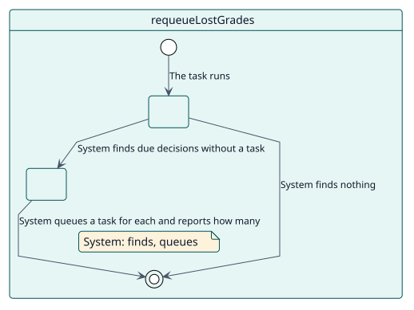
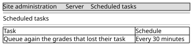

# UC-009 Poner de nuevo en cola las calificaciones que perdieron su tarea

| Resumen | Requisitos | Análisis | Diseño | Implementación | Pruebas |
| --- | --- | --- | --- | --- | --- |
| [Casos de uso](../../use-case-overview.svg) | **Requisitos** | [Análisis](../../../analysis/use-cases/requeueLostGrades/README.md) | [Diseño](../../../design/use-cases/requeueLostGrades/README.md) | [Implementación](../../../implementation/use-cases/requeueLostGrades/README.md) | [Pruebas](../../../implementation/use-cases/requeueLostGrades/README.md#pruebas) |

## Información del caso de uso

| Campo | Valor |
| --- | --- |
| Actor | Sistema |
| Paquete | Grading |
| Objetivo | Asegurar que ninguna decisión que ya venció se queda sin una tarea que la califique. |
| Tipo | Primario, esencial |
| Nivel | Objetivo de usuario |
| Requisito | RF-009 |
| Entidades del dominio | Decision |

## Contexto

Cada decisión tiene una tarea para su propio momento. Una cola vaciada a mano, un sitio trasladado entre servidores o un fallo pueden dejar una decisión vencida sin ella. Esta red de seguridad se ejecuta cada treinta minutos y, en un sitio sano, no encuentra nada.

## Precondiciones

- Hay decisiones pendientes.

## Postcondiciones

- Éxito: cada decisión vencida sin tarea vuelve a tener una.
- Fallo: un lote completo lo continúa la siguiente ejecución.

## Flujo principal

| Paso | Actor | Sistema |
| --- | --- | --- |
| 1 |  | Se ejecuta cada treinta minutos y busca decisiones pendientes que ya vencieron y no tienen tarea. |
| 2 |  | Pone en cola una tarea de calificación para cada una. |
| 3 |  | Indica cuántas puso de nuevo en cola y, cuando el lote estaba completo, que la siguiente ejecución continuará. |

## Flujos alternativos

| ID | Empieza en el paso | Condición | Comportamiento | Termina |
| --- | --- | --- | --- | --- |
| A1 | 1 | No hay ninguna. | No hace nada. | Fin |

## Reglas de negocio

| ID | Regla |
| --- | --- |
| RN-013 | Una decisión pendiente que venció y no tiene tarea detrás se pone de nuevo en cola; un sitio sano no encuentra ninguna. |
| RN-005 | Todo lo que importa se comprueba de nuevo cuando vence la calificación. |

## Especificación

Fuente de verdad del comportamiento: [specification.puml](./specification.puml)

## Prototipos

