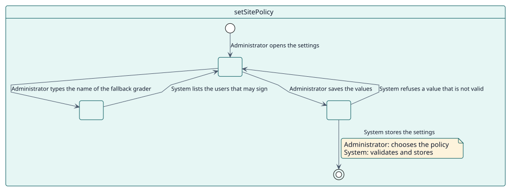
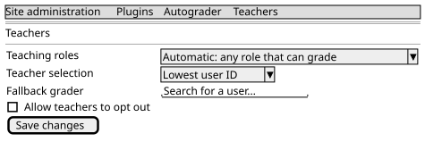

# UC-007 Establecer la política del sitio

| Resumen | Requisitos | Análisis | Diseño | Implementación | Pruebas |
| --- | --- | --- | --- | --- | --- |
| [Casos de uso](../../use-case-overview.svg) | **Requisitos** | [Análisis](../../../analysis/use-cases/setSitePolicy/README.md) | [Diseño](../../../design/use-cases/setSitePolicy/README.md) | [Implementación](../../../implementation/use-cases/setSitePolicy/README.md) | [Pruebas](../../../implementation/use-cases/setSitePolicy/README.md#pruebas) |

## Información del caso de uso

| Campo | Valor |
| --- | --- |
| Actor | Administrador |
| Paquete | Configuration |
| Objetivo | Decidir quién firma las calificaciones, qué avisos se envían y cuánto tiempo se conserva el historial. |
| Tipo | Primario, esencial |
| Nivel | Objetivo de usuario |
| Requisito | RF-008 |
| Entidades del dominio | SitePolicy, Grader, OptOut |

## Contexto

Los ajustes del plugin están en dos pestañas de la administración: los generales (avisos e historial) y los de los docentes (qué roles, cómo elegir entre ellos, el calificador de reserva y si se ofrece la exclusión).

## Precondiciones

- El administrador tiene `moodle/site:config`.

## Postcondiciones

- Éxito: los ajustes quedan guardados y se aplican desde la siguiente calificación.
- Fallo: un valor no válido se rechaza y se conserva el anterior.

## Flujo principal

| Paso | Actor | Sistema |
| --- | --- | --- |
| 1 | Abre los ajustes de Autograder en la administración. | Muestra la pestaña general y la de los docentes. |
| 2 | Elige si se notifica a los estudiantes, si se avisa a los docentes de los fallos y cuántos días se conserva el historial. | Valida los valores; cuando se activan los avisos de fallos, empieza su recuento desde ese momento. |
| 3 | Elige los roles que cuentan como docentes, cómo elegir entre varios docentes y si se ofrece la exclusión. | Los guarda; la siguiente calificación se elige con ellos. |
| 4 | Busca un calificador de reserva por nombre y elige uno. | Lista solo a los usuarios que pueden firmar y guarda el elegido. |

## Flujos alternativos

| ID | Empieza en el paso | Condición | Comportamiento | Termina |
| --- | --- | --- | --- | --- |
| A1 | 2 | La retención no es un número entero de días. | Rechaza el valor. | Paso 2 |
| A2 | 4 | El usuario elegido no puede ser el calificador de reserva. | Lo rechaza con un mensaje: los administradores y los usuarios sin un rol que califique nunca se usan. | Paso 4 |

## Reglas de negocio

| ID | Regla |
| --- | --- |
| RN-016 | Los administradores del sitio y los usuarios sin un rol que pueda calificar nunca son elegidos para firmar una calificación ni como calificador de reserva. |
| RN-004 | La calificación se registra a nombre de un docente del estudiante; sin docente, firma el calificador de reserva. |

## Especificación

Fuente de verdad del comportamiento: [specification.puml](./specification.puml)

## Prototipos

